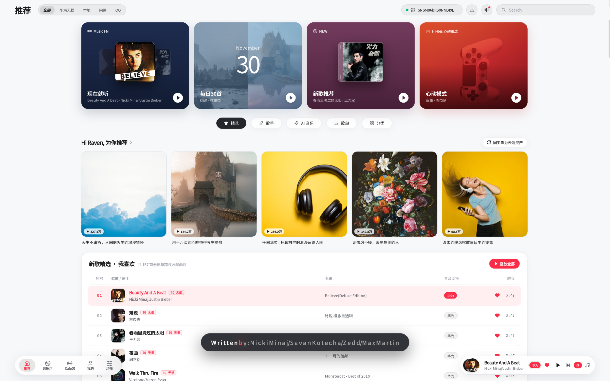

# Future Music Player

基于 **Tauri v2 (Rust) + React 19 + TypeScript** 构建的跨平台桌面无损音乐播放器，还原 **华为音乐 HarmonyOS NEXT / 鸿蒙 PC 版** 视觉体验，支持华为音乐云端资产同步、FLAC 24-bit 无损音频流直连、逐字歌词（HMRC / TTML / LRC）、多音源智能对齐回退及 10 段参量均衡器。



---

## 核心特性

- **HarmonyOS NEXT / 鸿蒙 PC 版界面设计**
  - 还原「现在就听 (`Music FM`)」、「每日30首」、「新歌推荐」、「心动模式」四张标志性推荐大卡片与 `Hi Raven, 为你推荐` 歌单矩阵。
  - 底部采用**左右双悬浮毛玻璃胶囊**设计（左侧导航胶囊：`推荐 / 音乐厅 / Cafe馆 / 我的 / 均衡`；右侧黑胶迷你播控胶囊）。
  - 全屏播放页配备**物理拟真旋转黑胶唱盘、金属唱臂自动起落动效、Audio Vivid 菁彩声空间光环**与高帧率逐字滚动歌词。
- **华为音乐无损直连与云端资产同步**
  - 内置受控 OAuth2 PKCE 扫码授权窗口与 `loginex` 加密会话管理。
  - 一键拉取华为音乐「我喜欢」收藏、自建歌单及云端 FLAC 无损音频流与 HMRC 逐字歌词。
- **跨平台多音源智能聚合与回退**
  - 支持华为音乐、本地无损目录扫描、网易云、QQ 音乐、Navidrome 私有云同名曲目自动合并挂载，遇到试听片段自动回退至完整无损音源。
- **声学工作台与 13 款全场景主题**
  - 内置基于 Web Audio API 的 **10 段参量均衡器**（含 Harman 曲线、原音直通、清澈人声、超重低音预设）。
  - 提供 **6 款温润浅色**（晨光、晴海、鼠尾草、暖砂、蔷薇、冰川）与 **7 款沉浸深色**（绯红暗夜、午夜蓝、深林、石墨、夜玫瑰、咖啡、曜石）主题色板。
- **原生系统集成**
  - 适配各操作系统的原生窗口标题栏与**系统托盘图标**（支持关闭主窗口最小化至托盘后台播放、托盘右键快捷切歌与桌面歌词开关）。

---

## 快速开始

### 1. 安装依赖与开发调试

```bash
pnpm install
pnpm dev
```

### 2. 运行测试

```bash
# 前端单元测试
pnpm test -- --run

# Rust 核心层测试
cargo test --manifest-path src-tauri/Cargo.toml
```

### 3. 打包本机安装程序 (`.rpm` / `.deb` / `.dmg` / `.msi`)

```bash
pnpm tauri build
```
